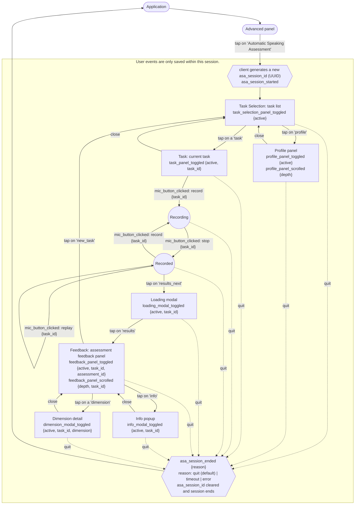

# User Event Flow

What the client sends to `POST /events` while a learner is in the Automatic Speaking
Assessment (ASA). Rules: [`app/models/events.py`](../app/models/events.py). Storage:
`user_events` and `user_event_durations` in [`app/schema.sql`](../app/schema.sql).

## Request

```json
{
  "guid": "<user GUID>",
  "asa_session_id": "<session UUID>",
  "app_version": "2.1.0",
  "events": [
    {
      "event_id": "<UUID, reused on resend>",
      "occurred_at": "2026-10-23T06:43:34.345Z",
      "name": "task_panel_toggled",
      "properties": { "active": true, "task_id": 1 }
    }
  ]
}
```

- 1–100 events, one session per batch. Gzip allowed, 10 MB max uncompressed.
- `occurred_at` needs a timezone; at most 30 days old, 5 minutes ahead.
- Properties must match the chart exactly, or the event is dropped.

## Response

| Status                     | Meaning                                                             | Client          |
| -------------------------- | ------------------------------------------------------------------- | --------------- |
| `202`, no body             | Received. Invalid events are dropped and logged on the server only. | Drop the batch. |
| `400`, `413`, `415`, `422` | Malformed batch. Nothing stored.                                    | Fix the client. |
| `403`, `404`, `409`        | No consent, no user, or user deleted. Nothing stored.               | Drop the batch. |
| `5xx`                      | Server fault. Nothing stored.                                       | Resend later.   |

## Chart

- Nodes are screens (panels/modals) with the events they send. Edges are taps; only record, stop and
  replay send their own event.
- `*_toggled` is sent on open (`active: true`) and close (`active: false`).
- Dotted edges: the learner can quit from any screen. `asa_session_ended` marks the quit
  time.


